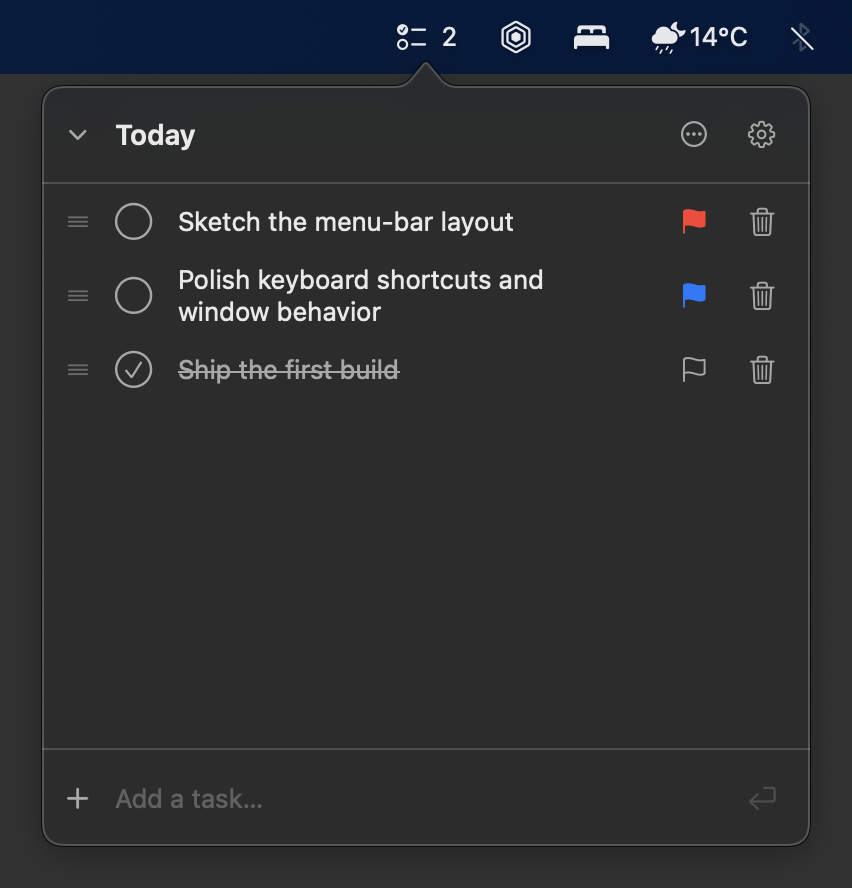

  

<h1 align="center">Todo Menu Bar</h1>

A small to-do app that lives in your Mac’s menu bar.

  

## Features

- Separate lists for work, home, or anything else.
- Add, edit, complete, and drag tasks into order.
- Flag priorities and clear completed tasks.
- Optional menu-bar task count and launch at login.

Your tasks stay on your Mac. No account, cloud sync, or tracking.

## Install

Requires an Apple silicon Mac running macOS 14 or later.

Download and open the [latest DMG](https://github.com/aleksa-codes/todo-menu-bar/releases/latest/download/Todo-Menu-Bar-macOS.dmg), then drag **Todo Menu Bar.app** to Applications. Prefer a ZIP? [Download it here](https://github.com/aleksa-codes/todo-menu-bar/releases/latest/download/Todo-Menu-Bar-macOS.zip), unzip it, and move the app to Applications.

The app is not notarized. If macOS blocks the first launch, allow it under System Settings > Privacy & Security.

## Develop

Install Xcode Command Line Tools with Swift 6.2, then run `make run` to build and open the app. Use `make check` to check your changes.

## License

MIT. See [LICENSE](LICENSE).
